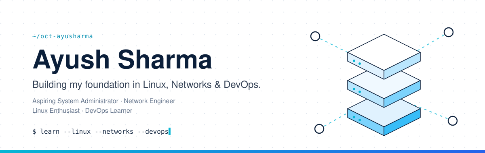

 

<!-- Optional portfolio:

-->

 
---

## 👋 About Me

I'm **Ayush Sharma**, a beginner building practical skills in **system administration, networking, Linux, and DevOps**. I learn by building small labs, breaking them, fixing them, and writing down what I learned.

## 📈 GitHub Activity

<!-- OPTIONAL 1: 3D contribution graph. Uncomment AFTER its GitHub Action has run once:

-->

<!-- OPTIONAL 2: Contribution snake. Uncomment AFTER its GitHub Action has run once:

-->

Contribution stats are a rough activity indicator, not a measure of engineering ability.

<a href="#top" title="Back to the top">↑ Back to top</a>

---

## 🤝 Let's Collaborate

I'm happy to work on **beginner-friendly Linux, networking, and DevOps projects**, swap lab ideas, or compare notes on troubleshooting. My approach is simple: experiment, break things safely, and document what I learn.

[-06B6D4?style=for-the-badge&labelColor=0B1F3A)](https://github.com/oct-ayusharma/oct-ayusharma/issues/new?title=Hello+Ayush&body=Hi+Ayush%2C+I%27d+like+to+talk+about%3A+ "Opens a pre-filled GitHub issue")

<a href="#top" title="Back to the top">↑ Back to top</a>

